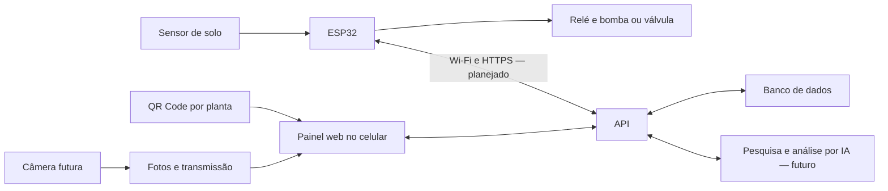

# 🌱 WaterMyPlants

**Irrigação e acompanhamento de plantas com ESP32, painel web e histórico por vaso.**

Projeto em construção, documentado desde o primeiro sensor conectado: componentes, ligações, firmware, experimentos, resultados e modelos físicos. A proposta é acompanhar várias plantas pelo celular e automatizar a rega conforme as condições de cada vaso.

## MVP 0.1.0 — painel independente

O painel está integralmente neste repositório, em [`web/painel`](web/painel/README.md), e funciona sem plataforma de geração de sites, conta ou login externo. HTML, CSS e JavaScript separados, com servidor local em Node.js e sem dependências npm de execução.

Na raiz do projeto, com Node.js 20 ou superior:

```sh
npm start
```

Abra [http://127.0.0.1:4178](http://127.0.0.1:4178). Não é necessário instalar pacotes para iniciar esta versão. Para verificar o código e executar os testes:

```sh
npm run check
npm test
```

Cadastro, edição, filtros, QR Codes, anotações e exportação funcionam no navegador. Os cadastros usam armazenamento local; as plantas iniciais, os índices e os gráficos são demonstrativos. Não há conexão do painel com ESP32, câmera, IA ou banco nesta versão.

Para hospedar em um domínio próprio ou serviço de sua escolha, publique **somente `web/painel/dist/`** em um servidor estático. Os QR Codes usam automaticamente o endereço em que o painel estiver aberto, inclusive em subpastas. Esta entrega é o código independente e versionado; nenhuma nova hospedagem externa foi contratada/configurada. [Notas da primeira versão](CHANGELOG.md).

## O que já funciona

- [x] ESP32 conectado ao computador por microUSB.
- [x] Sensor capacitivo alimentado em 3,3 V e lido pelo D34/GPIO34.
- [x] Leituras no Monitor Serial usando PlatformIO e framework Arduino.
- [x] Calibração inicial: **3060 para terra seca** e **2107 para terra úmida**.
- [x] Média de 20 amostras e exibição de índice relativo entre 0 e 100%.
- [x] Resultados dos primeiros testes registrados.

**Próximo teste preparado:** conexão Wi-Fi e página local para ver a leitura pelo celular; validação física pendente. Veja o [passo a passo do T004](docs/testes/T004-wifi-local.md).

**Ainda não implementados:** API na nuvem, banco, painel completo, QR Codes, câmera, análise por IA e acionamento da bomba. O teste inicial do sensor foi executado pelo autor no hardware; não há validação de irrigação automática.

## Visão do projeto

Cada planta terá uma página com nome, espécie, vaso, substrato, sensor associado, últimas leituras e histórico. Um **QR Code na planta** abrirá essa página no celular. A identificação da espécie poderá ajudar a pesquisar cuidados com fontes e propor um perfil de rega.

Mais adiante, câmeras registrarão **uma foto por dia**, com galeria de evolução e visualização ao vivo sob demanda. A análise por IA combinará fotos, espécie e histórico para sugerir possíveis causas de problemas e próximos passos de observação. Essa análise será uma hipótese assistida, não um diagnóstico garantido nem uma autorização direta para acionar a bomba.

As regras de rega ficarão no controlador, com limites de tempo e tratamento de falhas, para que a operação não dependa de uma conexão permanente com a nuvem.



## Primeiro teste: sensor de solo

Desconecte o USB para montar os fios. Use os nomes impressos nas placas; a posição e as cores dos cabos podem variar.

| Sensor | ESP32 | Função |
|---|---|---|
| VCC | 3V3 | Alimentação de 3,3 V |
| GND | GND | Referência e retorno |
| AOUT, também transcrito como AUOT | D34 / GPIO34 | Saída analógica |

Neste teste, o ESP32 recebe energia pelo USB do computador. Relé, bomba e carregador externo ficam fora do circuito.

1. Abra a pasta [`firmware/esp32`](firmware/esp32) como projeto no PlatformIO.
2. O perfil usado é **Espressif ESP32 Dev Module** (`esp32dev`), com framework **Arduino**.
   Para habilitar o Wi-Fi da versão atual, copie `include/secrets.example.h` para `include/secrets.h` e preencha suas credenciais somente nesse arquivo local. Sem configuração, a leitura serial continua disponível.
3. Compile com **Build** e grave com **Upload**.
4. Abra o **Monitor Serial em 115200 baud**.
5. Compare leituras na terra seca e úmida, mantendo a mesma profundidade e sem tocar na haste.

Com a CLI do PlatformIO instalada, na pasta do firmware:

```sh
pio run
pio run --target upload
pio device monitor --baud 115200
```

Saída observada no teste do autor:

```text
Leitura: 2097 | Indice relativo: 100.0%
Leitura: 2474 | Indice relativo: 61.5%
```

**O índice não é o percentual real de água no solo.** É uma escala entre duas referências experimentais. Fora da terra também pode indicar 0%; portanto, 0% sozinho não comprova que o sensor esteja corretamente instalado. Limites de rega ainda não foram definidos.

## Documentação

| Conteúdo | Arquivo |
|---|---|
| Etapas e critérios de conclusão | [Roteiro](docs/ROTEIRO.md) |
| Componentes, alimentação e ligações | [Hardware](docs/HARDWARE.md) |
| Entidades, painel, QR Code, câmera e IA | [Arquitetura](docs/ARQUITETURA.md) |
| Testes realizados e resultados | [Diário de desenvolvimento](docs/DIARIO.md) |
| Como registrar os próximos testes | [Procedimento de documentação](docs/COMO-DOCUMENTAR.md) |
| Amostras de calibração | [Dados em CSV](docs/testes/2026-10-19-calibracao.csv) |
| Estudo elétrico inicial e pendências | [Projeto inicial](PROJETO.md) |
| Modelos e referências visuais | [Modelos](models/README.md) |

## Expansão

O módulo atual tem dois canais de relé, mas há apenas um sensor e uma bomba disponíveis. Para controlar vasos independentemente, será necessário definir sensores e caminhos hidráulicos próprios, com bombas ou válvulas adequadas. A arquitetura separará plantas, sensores, controladores e zonas de irrigação para permitir novos canais e novos ESP32.

## Próxima etapa

Já há um [painel personalizado de demonstração](web/painel/README.md), com cadastro por planta, busca, QR Codes e linha do tempo local. Seus índices e gráficos são ilustrativos, ainda sem conexão com o ESP32. O desenvolvimento e os testes estão registrados no [T005](docs/testes/T005-painel-demo.md).

O autor confirmou o funcionamento do teste Wi-Fi e da página local do [T004](docs/testes/T004-wifi-local.md); os casos de falha/reconexão ainda precisam de resultados. O próximo passo de integração é definir a API e o armazenamento das leituras e conectar o painel aos dados reais. O controle da bomba será testado depois de confirmar alimentação, corrente e compatibilidade do relé.

## Referências técnicas

- [ADC no Arduino-ESP32](https://docs.espressif.com/projects/arduino-esp32/en/latest/api/adc.html)
- [Perfil esp32dev no PlatformIO](https://docs.platformio.org/en/stable/boards/espressif32/esp32dev.html)
- [Irrigação orientada por sensores — University of Minnesota Extension](https://extension.umn.edu/natural-resources/conservation/agricultural-soil-and-water/irrigation/soil-moisture-sensors-for-irrigation-scheduling)

Credenciais de Wi-Fi, tokens e chaves de API não devem entrar no repositório. A licença do projeto ainda será escolhida pelo autor.
